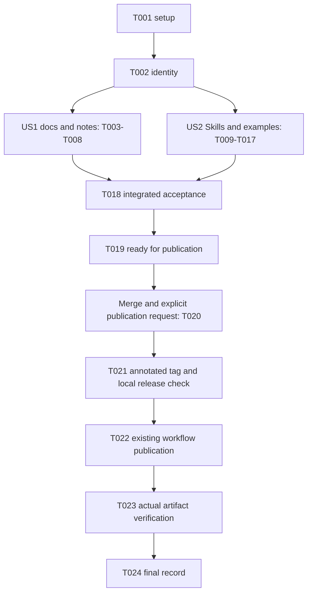

# Tasks: Ecosystem Release and Skills Update

**Input**: Design documents from `specs/509-ecosystem-release/`.

**Prerequisites**: `spec.md`, `plan.md`, `research.md`, `data-model.md`,
`contracts/release-contract.md`, `contracts/skills-contract.md`, `quickstart.md`.

**Tests**: Reuse the existing checks required by FR-012–FR-014. The small release-notes code
change requires a failing regression first under Constitution III. Executable Skill examples
contain assertions and run through the existing runner. No new test framework, external
application test, consumer-application review or manual agent evaluation is included.

**Organization**: Shared setup/identity, three user stories, then final evidence reconciliation.
All stories are P1 in the spec. Only essential release work is included.

## Format: `[ID] [P?] [Story] Description`

- `[P]` marks different-file work that can run concurrently after its stated prerequisites.
- `[US1]`, `[US2]`, `[US3]` map to the specification's user stories.
- Paths are relative to the repository root. Run toolchain commands inside `nix develop`.
- A checkbox records completed work and observed evidence, never an intention or assumed result.

## Execution Boundary and Scope

Before every task ask: **“Is this necessary to release 0.13.0 correctly, or can it wait until
0.13.1?”** Record optional findings for later releases. A failed required check, wrong artifact
or unsound semantic claim remains blocking. Preserve unrelated Spec Kit changes and user work.

**Implementation covers T001–T019.** A request to implement this feature does not authorize
publication. T020–T023 require merge and a later explicit publication request; leave them
unchecked until their conditions are met. T024 is finalized after published verification.
Do not create/push a product release tag during preparation. Tags used by regression tests
exist only in disposable repositories. Do not report Feature 509 complete at the preparation
checkpoint.

Record results in `specs/509-ecosystem-release/implementation-log.md`. During final tag/build
operations keep that log in the maintainer worktree, separate from the clean selected release
checkout, so recording evidence does not dirty or change the tagged source. Do not regenerate
historical evidence or introduce a new tracking/evidence schema.

## Phase 1: Setup

**Purpose**: Establish a short auditable record without initializing new infrastructure.

- [X] T001 Create `specs/509-ecosystem-release/implementation-log.md` with starting commit, scope boundaries, preparation/publication status and a findings table; use the data-model fields “issue, concrete impact, evidence/location, blocking/nonblocking classification and disposition”; suggestions also record “benefit and necessary/approval/deferred decision” and a later release when deferred. Record existing unrelated work so it stays outside release changes.

## Phase 2: Foundational — Confirm Release Identity

**Purpose**: Establish the shared release identity before editing docs or examples.

- [X] T002 Confirm `Cargo.toml` already declares Behavior 0.13.0 and justify the minor release from published 0.12.0 under `docs/versioning.md`; verify `core-release.json` and the supported dependency graph still identify Core 0.15.0 commit `6b93898a9375113f7a8946f23ab5535319b6f5d6`, unchanged asset digests and verifier 0.10.0. Record the Feature 508 ancestry/dependency in `specs/509-ecosystem-release/implementation-log.md`. Retain the existing version source and pin; do not repeat Core adoption or modify compatibility fixtures.

**Checkpoint**: Identity is known. US1 and US2 content work can proceed independently.

## Phase 3: User Story 1 — Prepare a Consistent Release (Priority: P1)

**Goal**: Accurate current metadata/documentation and substantive release notes through the
existing release process.

**Independent Test**: The existing release-script regression proves generated notes retain
exact identity and include the authored changes; README/versioning/notes agree with T002.
Final package/gate acceptance is integrated in T018 after both content stories are ready.

### Test first

- [X] T003 [P] [US1] Add a focused notes regression in `python/tests/test_release_scripts.py`, following its disposable-repository/stub style, that requires `scripts/release.sh` to preserve its generated release/Core identity header and append the versioned authored notes into `dist/v0.13.0/NOTES.md`; observe it fail before changing the script. Do not create product tags or publish from the real worktree.

### Release content and integration

- [X] T004 [P] [US1] Write `release/notes/0.13.0.md` covering changes since 0.12.0: StateMachine, RequestFlow, Approval, WorkQueue, Model composition and Core verification improvements, including consumer adaptations and the distinction between Behavior 0.13.0, Core 0.15.0 and verifier 0.10.0. This is one committed prose source, not a new note generator.
- [X] T005 [US1] After T003 and T004, minimally extend the existing NOTES generation in `scripts/release.sh` to append `release/notes/0.13.0.md` for this release while retaining the generated exact version/Core header, build/check behavior and existing workflow integration; introduce no second release process or artifact format.
- [X] T006 [P] [US1] Update the current 0.13.0 entry and version examples in `docs/versioning.md` using T002's policy rationale and exact Core/verifier identity; explain current consumer adaptations and preserve the existing policy and genuinely historical release/evidence content.
- [X] T007 [P] [US1] Update `README.md` to describe the four Models and composition, current public command authoring, exact Core 0.15.0 and verifier 0.10.0; correct the obsolete claim that release.sh creates the tag, and document preparation followed by merge, explicit authorization, annotated tag/check/build and existing tag-triggered publication.
- [X] T008 [US1] After T005–T007, run the focused notes regression from `python/tests/test_release_scripts.py` with `BEHAVIOR_RELEASE_TESTS=1` in Nix and confirm it is green; review `README.md`, `docs/versioning.md` and `release/notes/0.13.0.md` for consistent identity and publishable claims. Record the observed red/green and documentation review results in `specs/509-ecosystem-release/implementation-log.md`.

**Checkpoint**: US1 content and notes integration work independently. No product tag or
publication has occurred; the integrated release checks are still required.

## Phase 4: User Story 2 — Use Accurate Consumer Skills (Priority: P1)

**Goal**: Update the three established Skills with concise public examples and honest evidence
boundaries, without changing APIs or building a reference application.

**Independent Test**: Existing `python/tests/test_skills.py` passes for all three Skills and
examples; public API/equivalence checks pass. The installed-wheel run in T018 checks the same
examples in copied empty directories.

### Essential executable examples

Each example must run alone with only the installed package and standard library. Use public
root exports, no private modules, repository helpers, hand-written IR or copied Core fixtures.
Examples may be combined if shorter while preserving the same coverage; record any changed
example paths and update the cited excerpts accordingly.

- [X] T009 [P] [US2] Add `skills/behavior-authoring/examples/models_composition.py` with a small standalone StateMachine plus RequestFlow and Approval composed over `request_entity`; assert successful public construction, generated `request_entity`/`decision_entity`, an Approval outcome handle, receipts and a correctly rejected ownership violation. Keep rules and generated meaning in the existing Models/Core.
- [X] T010 [P] [US2] Add `skills/behavior-authoring/examples/work_queue.py` demonstrating explicit authorization, generated work entity/read names, a state-bound completion effect and successful public construction with assertions; preserve WorkQueue's positional-subject/named-parameter callable convention and the rule that bindings grant no ownership authority.
- [X] T011 [P] [US2] Add `skills/behavior-verification/examples/approval_verification.py` using a small public Approval and assert actual local postcondition outcomes are proven under verifier 0.10.0; distinguish those local results from structural global arguments, tests and assumptions, and never turn an INCONCLUSIVE outcome into success.
- [X] T012 [P] [US2] Add `skills/behavior-application/examples/work_queue_store.py` with an asserted enqueue→claim→current-generation completion using trusted worker/time context, an atomic bound-entity effect and durable command intent, command observation and replay. Use a self-contained explicit public Store-v2 policy if needed; include no scheduler, physical side effect or claim of exactly-once external execution.

### Guidance, after the cited examples exist

- [X] T013 [P] [US2] After T009–T010, update `skills/behavior-authoring/SKILL.md` in its established structure with Model selection, essential patterns, composition, ownership and generated entities; correct obsolete command-authoring/semantic-gap claims, preserve the exact gap rule and release 0.13.0, and cite verbatim executable excerpts with `# from examples/<file>.py`. Preserve actual SM/RF, Approval and WorkQueue callable conventions.
- [X] T014 [P] [US2] After T011, update `skills/behavior-verification/SKILL.md` in place for verifier 0.10.0 and the fixed Approval query-congruence case; preserve unrelated precision-debt cases unless actual pinned results demonstrate resolution, distinguish local SMT/global structural/test/contract evidence and host assumptions, retain INCONCLUSIVE as unproven, and cite matching excerpts from `examples/approval_verification.py`.
- [X] T015 [P] [US2] After T012, update `skills/behavior-application/SKILL.md` in place for Models/Store, atomicity, replay, trusted context, durable intents and WorkQueue's state-transition boundary; retain backend/migration guidance and explain time/genesis/migration assumptions. Cite the new example and reuse `skills/behavior-application/examples/conflict.py` assertions to distinguish new evaluation after conflict from resubmitting the original bundle after lost acknowledgement.
- [X] T016 [P] [US2] Refresh `skills/README.md` selection and current capability/semantic-gap guidance for the four Models and public command authoring; preserve the three-Skill layout, release-tag consumption instructions, exact gap rule, seven fixed gap fields and historical entries. Add no installer, fourth Skill or example registry.
- [X] T017 [US2] After T009–T016, build the development package through existing Nix/fetch/maturin commands and run `python -m pytest -q python/tests/test_skills.py python/tests/test_public_api.py python/tests/test_binding_equivalence.py`; confirm the three Skill versions, root-public references, verbatim excerpts and all self-contained assertions pass. Record results in `specs/509-ecosystem-release/implementation-log.md`; do not add a new runner or external agent evaluation.

**Checkpoint**: All required Skills topics have runnable coverage. Existing examples remain
unless a real release mismatch requires correction. This does not yet publish the release.

## Phase 5: User Story 3 — Publish and Verify the Immutable Release (Priority: P1)

**Goal**: Integrate validation, finish preparation, and then deliver the merged immutable release
in the separately authorized publication step.

**Independent Test**: A ready candidate has passing existing package/full gates and independent
complete 506/507 reports. After authorized publication, actual downloaded wheel bytes,
manifest/tag/merged-source identity and repeat-build checks all match, with a recorded release URL.

### Implementation: candidate acceptance and handoff

- [X] T018 [US3] After T008 and T017, validate a committed candidate in a clean isolated checkout as described in `specs/509-ecosystem-release/quickstart.md`: run `scripts/release-build.sh 0.13.0 dist/v0.13.0`, `scripts/release-check.sh dist/v0.13.0`, then `scripts/conformance.sh 506 complete` and `scripts/conformance.sh 507 complete` in Nix. Require “Manifest Core identity equals core-release.json; installed version reports equal the manifest”, “Both conformance reports say complete; all required checks and obligations passed”, and identical repeat builds under existing checks. Record the covered commit, commands and outcomes in `specs/509-ecosystem-release/implementation-log.md`; keep reports in `target/conformance/`. The release check already runs full `scripts/gates.sh`, including 507's quick runtime gate; do not waive checks or repeat unchanged successful runs gratuitously.
- [X] T019 [US3] After T018, review the candidate against `specs/509-ecosystem-release/contracts/release-contract.md` and `contracts/skills-contract.md`, confirm all essential coverage and all mandatory checks passed, classify remaining findings and record the status **ready for publication** in `specs/509-ecosystem-release/implementation-log.md`. Prepare only intended release changes for the existing review/merge process; exclude unrelated `.specify/` and `.agents/` changes. Stop implementation here with T020–T024 unchecked and no product release tag pushed.

### Publication: only after merge and a later explicit publication request

These tasks remain part of Feature 509's definition of done, but are not authorized by the
implementation request. A permission grant for local development does not replace the explicit
publication request required by FR-015. Missing authorization is an expected preparation boundary.

- [ ] T020 [US3] After release changes are merged and publication is explicitly requested, record that request and the selected merged source commit in `specs/509-ecosystem-release/implementation-log.md`; refresh main/tags, confirm inclusion of 508 and 509 and successful existing `pin surface gates package` checks from `.github/workflows/ecosystem-ci.yml`, ensure v0.13.0 is unused, and revalidate final source when T018 evidence covers a different commit. Enforce “Publication requires merged source, successful required CI and explicit authorization” using a clean selected release checkout; leave this and following tasks unchecked until those conditions hold.
- [ ] T021 [US3] After T020, create annotated `v0.13.0` on the selected commit, run authenticated `scripts/check-tag.sh v0.13.0` with `GITHUB_REPOSITORY=kallistoteles/behavior-ir` and `CHECK_TAG_REQUIRED='pin surface gates package'`, then `scripts/release.sh 0.13.0` as documented in `specs/509-ecosystem-release/quickstart.md`; verify `dist/v0.13.0/NOTES.md` contains generated exact identity and authored release notes. Never move or overwrite an existing tag.
- [ ] T022 [US3] After T021, push only `refs/tags/v0.13.0` to origin and wait for `.github/workflows/ecosystem-release.yml` to finish its existing check/build/publication sequence; record workflow outcome and release URL in `specs/509-ecosystem-release/implementation-log.md`. On failure preserve evidence and immutable tags/artifacts; use existing recovery policy, not another publisher or silent replacement version.
- [ ] T023 [US3] After successful T022 publication, follow the verification section of `specs/509-ecosystem-release/quickstart.md`: download actual assets to a dedicated temporary directory, run `sha256sum -c SHA256SUMS`, compare the downloaded `release-manifest.json` against `dist/v0.13.0/release-manifest.json`, and run `scripts/release-verify.sh v0.13.0 kallistoteles/behavior-ir`. Require “Tagged commit, manifest commit and verified merged release commit are identical” and “Downloaded wheel bytes satisfy published SHA256SUMS; published checksum and manifest content agree with the local tagged build”; confirm the published release body and record actual results/URLs in `specs/509-ecosystem-release/implementation-log.md`. Checksum text equality alone is insufficient.

**Checkpoint**: Only successful actual publication and verification satisfy US3 and the release
deliverable. Missing authorization, a partial publication or failed verification leaves it pending.

## Phase 6: Polish & Cross-Cutting Concerns — Final Evidence Only

**Purpose**: Finish the record; do not add optional polish or engineering work.

- [ ] T024 After T023, finalize `specs/509-ecosystem-release/implementation-log.md` and reconcile `specs/509-ecosystem-release/tasks.md` with observed results: record the verified release URL/commit and ensure every nonblocking finding has a later-release disposition and every significant suggestion a benefit plus necessary/approval/deferred decision. Mark Feature 509 complete only with all required publication evidence; retain any unresolved required failure as blocking and preserve historical tags, records and attestations.

## Dependencies & Execution Order

### Phase and task dependencies

| Work | Prerequisites |
|---|---|
| T001 setup record | None |
| T002 identity | T001 |
| US1 file work T003, T004, T006, T007 | T002; independent files |
| T005 notes integration | Red regression T003 and authored notes T004 |
| T008 US1 review/regression | T005, T006, T007 |
| US2 examples T009–T012 | T002; independent files |
| US2 guidance T013–T016 | Corresponding cited examples as stated; T016 only needs T002 |
| T017 US2 validation | T009–T016 |
| T018 integrated candidate acceptance | T008 and T017 |
| T019 implementation handoff | T018 |
| T020 publication preconditions | T019, merge and later explicit publication request |
| T021 → T022 → T023 | Strict sequence after T020 |
| T024 final record | T023 |

US1 and US2 content work is independently implementable/testable after identity is confirmed.
US1's final release-gate acceptance and US2's installed-wheel acceptance are integrated once
in T018; neither publication nor final release completion can precede that integration.

### Parallel execution examples per story

| Story | Safe opportunities | Sequential boundary |
|---|---|---|
| US1 | After T002, T003 test, T004 notes, T006 versioning and T007 README can proceed in separate files | T005 waits for T003/T004; T008 validates the finished content |
| US2 | After T002, T009–T012 examples can proceed independently; after cited examples exist, T013–T016 edit separate guidance files | T017 waits for examples and excerpts to agree |
| US3 | No independent publication tasks; keep candidate acceptance, handoff, authorization, tag, publish and verify serial | T020 cannot run merely because T019 is finished |

Only the coordinator writes the shared implementation log and runs integrated builds/checks.
Parallel content authors return evidence for the coordinator to record, avoiding same-file edits
and competing builds. These opportunities do not require spawning extra agents.

## Implementation Strategy

### First useful increment

Finish US1 content (T003–T008) to obtain accurate release metadata and tested notes. This is
independently reviewable but is not a shippable Feature 509 while required Skills remain stale.

### Minimum coherent release preparation

Complete setup/identity, US1 and US2, then T018–T019. This is the smallest **ready-for-publication**
increment satisfying the preparation scope. Preserve all existing gates; fix release blockers
only and record noncritical improvements for 0.13.1 or later.

### Incremental delivery and publication

1. Confirm the exact identity and scope.
2. Complete independently testable US1 and US2 content, using parallel file work where useful.
3. Run the existing integrated acceptance once on the completed candidate.
4. Stop at ready for publication; obtain merge and the separate explicit publication request.
5. Resume T020–T023 through the existing process; finalize T024 only after published verification.

No new Models, Core semantics, platforms, release system, consumer application review or manual
agent evaluation is part of any increment. No application/runtime data migrations are introduced;
the data-model document describes release artifacts, evidence and reporting states only.

## Requirement Coverage

| Requirements / outcomes | Tasks |
|---|---|
| FR-001–FR-005; SC-001 | T002–T008, T018 |
| FR-006–FR-007; Model authoring and composition | T009–T010, T013, T016–T017 |
| FR-008–FR-009; honest verification evidence | T011, T014, T017 |
| FR-010–FR-011; host, WorkQueue and retry boundaries | T012, T015, T017 |
| FR-012; SC-002; essential installed-package examples | T009–T018 |
| FR-013; SC-003; all existing gates and complete conformance | T018, T020–T021 |
| FR-014–FR-016; SC-004–SC-005; immutable verified artifacts | T018–T023 |
| FR-017–FR-020; SC-006; findings and optional scope | T001, T019, T024 and the scope test applied to every task |
| FR-021; published deliverable | T020–T024 |
